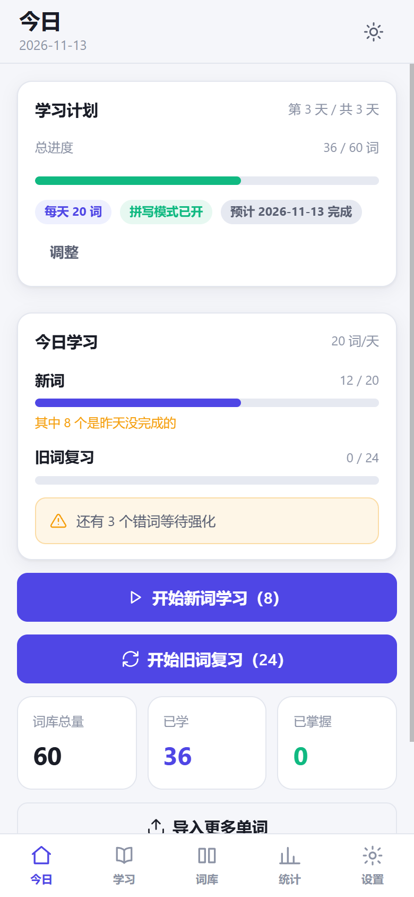
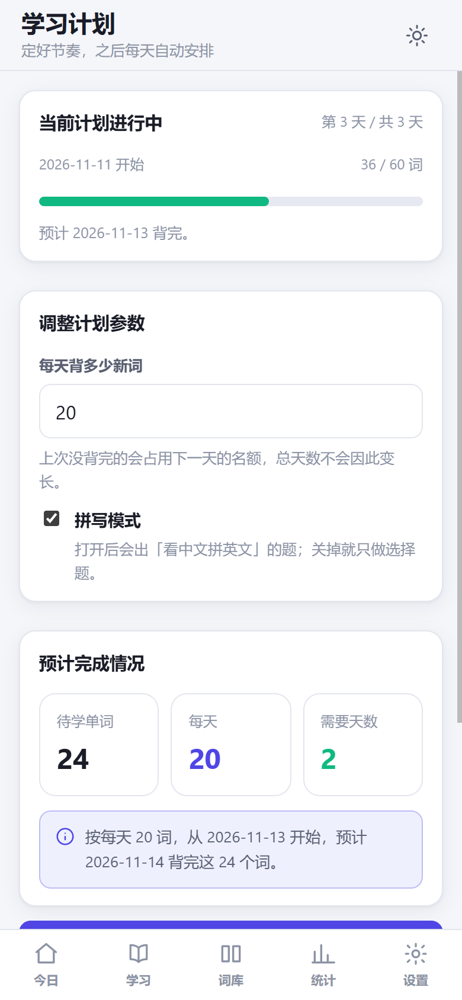
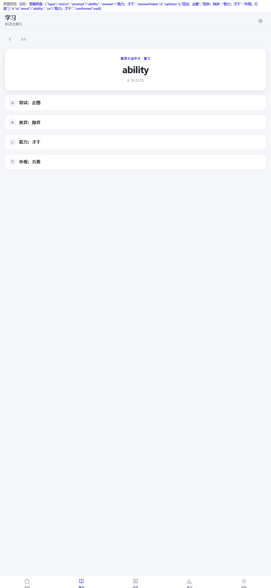
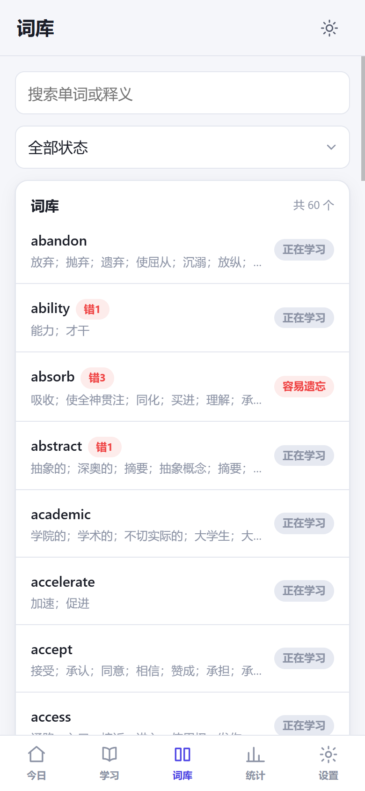
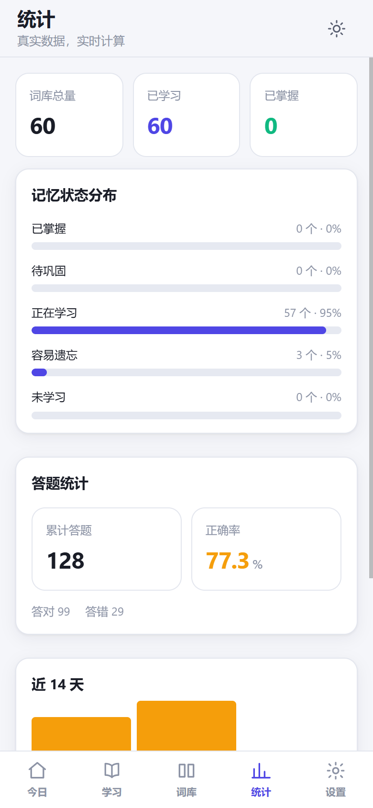
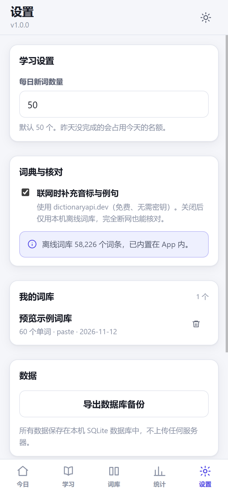

# 词忆 · 智能英语单词记忆　v1.1.0

导入 Word / 粘贴单词表 → 词典核对中文释义 → 确认后本地存储 → **制定学习计划** → 每天自动排任务离线学习 → 间隔重复复习 → 真实统计。

全部数据存在本机 SQLite（WASM）里，学习阶段不需要任何网络。

---

## 学习计划（v1.1 新增）

不再是"打开 App 就自动出任务"，改成**先定计划、点开始、之后自动跑**：

```
导入 600 个词
  ↓
打开「学习计划」页
  · 每天背多少新词：50（可调 1~200）
  · 拼写模式：开 / 关
  · 实时显示：待学 600 词 ÷ 每天 50 词 = 预计 12 天，2026-11-24 背完
  ↓
点「开始学习计划」
  ↓
之后每天打开 App，当天的词已经排好了 —— 不用每天再点一次
```

- 计划有一套独立记录：开始日期、每天词数、覆盖词数、拼写开关、状态
- 未完成的词照旧继承，并占用第二天的名额
- 全部背完后计划自动标记为「已完成」，不会一直挂着
- 随时可以「结束当前计划」，也可以重新制定（旧计划转为 cancelled，已学内容不受影响）
- 没有进行中的计划时，首页引导你去制定；旧词复习仍然照常进行

**拼写模式**在设置页和学习计划页都能开关，关掉之后所有出题都不会出「看中文拼英文」的题（`core/quiz.js` 的 `activeTypes()` 统一过滤，测试里连出 40 次题验证过）。

---

## 现在就能跑起来

```powershell
cd "D:\personal\学习\英文单词记忆"
python serve.py
```

浏览器会自动打开 `http://127.0.0.1:8899/index.html`。

> 已经在运行中：<http://127.0.0.1:8899/index.html>

需要 **Python 3**（只用标准库，无第三方依赖）。

---

## 界面

下面都是在**真实手机视口（390×844 @2x）**下、用真实运行中的 App 截的，数据由真实词典词条生成。

| 今日（有计划） | 学习计划 | 答题 |
|---|---|---|
|  |  |  |

| 词库 | 统计 | 设置 |
|---|---|---|
|  |  |  |

字体、间距、底部导航、状态徽标、进度条、条形图都是 CSS 实打实渲染的，没有用图片拼。

截图脚本：`tools/cdp-shot.ps1`（用 Chrome DevTools Protocol 精确设置视口，顺带在同一会话里先跑 `tools/seed.html` 把数据灌进去）。

---

## 验收测试

```powershell
node test/run.mjs        # 核心逻辑：235 项（离线可复现）
node test/ui-smoke.mjs   # UI 端到端：51 项（DOM 垫片里真跑 app.js）
node test/online.mjs     # 在线词典：21 项（打真实 API，断网自动跳过）
```

最近一次结果：

| 测试 | 结果 | 说明 |
|---|---|---|
| `test/run.mjs` | **235 / 235 通过** | 18 个测试段，覆盖需求里 12 个验收场景 + 学习计划 |
| `test/ui-smoke.mjs` | **51 / 51 通过** | 在 Node 里真实执行 `web/app.js`，跑完导入→制定计划→出题→答题→强化全流程 |
| `test/online.mjs` | **21 / 21 通过** | 真实请求 dictionaryapi.dev，验证解析、词性归一化、写库 |

合计 **307 项**。测试跑的是**真实 SQLite 与真实词典数据**，没有任何模拟返回值。

APK 另有 `android/tools/verify_apk.py` 做 41 项静态校验。

---

## 它怎么工作的

### 导入

| 来源 | 支持的形式 |
|---|---|
| 粘贴 | `apple 苹果`、`apple\t苹果`、`apple,苹果`、`apple:苹果`、`apple /ˈæpl/ n. 苹果`、`苹果 apple`（中文在前）、带例句的行 |
| .docx | 两列表格、三列（英文/词性/中文）、四列（含音标）、纯段落 |

docx 里的表格**不假设列顺序**：`parse.js` 会统计每一列的内容特征（英文占比、中文占比、词性占比、音标占比），自己判断哪列是什么。表头会被自动识别并跳过——包括 `Word | POS | Chinese` 这种全英文表头。

### 去重

- 按 `小写 + 去空白` 归一化
- 同一个词的**不同义项、不同词性全部保留并求并集**
  - `charge 充电` + `charge 收费` → `充电；收费`
  - `abandon vt. 放弃` + `abandon n. 放任` → 词性 `v,n`，释义 `放弃；放任`
- 义项按**完全相同**去重（不用子串，否则 `苹果树` 会被 `苹果` 吞掉）
- 重复导入已存在的词 → 复用同一条记录，**学习记录原样保留**

### 翻译核对

这是最需要小心的地方。判断的是**义项是否对应**，不是字面是否相等。

```
abandon 放弃;抛弃      vs 词典 放弃;遗弃;抛弃    → A 正确
abandon 放弃;遗弃;抛弃 vs 词典 放弃;遗弃;抛弃    → A 正确
accurate 准确的        vs 词典 正确的;精确的      → A 正确（同义改写）
charge 充电            vs 词典 指控;费用;冲锋;… → B 不完整（不是错误！）
accurate 水果          vs 词典 正确的;精确的      → D 确认错误
xyzzyxxx 随便什么      vs 词典无此词              → E 无法确认
```

三种手段避免误报：

1. **中文近义词表**——纯字符重叠解决不了 `实现` 和 `完成` 的关系。这张表从 ECDICT 自身推导：如果两个中文义项被多个相同的英文词共用（比如 `accomplish` 同时译作「完成」和「实现」），它们就互为近义。产物 `data/syn.json.gz`，49658 个义项，0.66 MB。
2. **覆盖不全不算错**——`charge` 写「充电」是正确词义之一，最多降级成 B，绝不判 D。
3. **拿不准就说拿不准**——词典没收录就返回 E，不硬下结论。

原始释义 `original_translation` **永远不会被自动覆盖**。库里同时保存 `original_translation` / `suggested_translation` / `confirmed_translation` 三份，只有你点「采用建议」或「手工修改」才会写 `confirmed_translation`，且每次核对都留一条历史记录。

### 记忆算法

SM-2 风格，纯函数实现在 `core/srs.js`：

```
初始 ease 2.3，范围 1.3 ~ 2.6
首次学习          → 1 天后
第 1 次正式复习答对 → 3 天
第 2 次正式复习答对 → 7 天
第 3 次及以后      → 上次间隔 × ease，上限 365 天
答错              → 连续对归零、lapses+1、ease-0.2、1 天后重来、标记「容易遗忘」
```

**关键分离**：当天重复强化不改长期间隔。只有「当天第一次独立作答」才推进间隔——否则今天答错三次、第三次蒙对，就会被错误地推到 7 天后。

### 每日任务

- 默认 50 个新词（设置里可改）
- 昨天没做完的**继承到今天并占用名额**：剩 15 → 今天 = 15 继承 + 35 新词
- 继承超过 50 时优先安排最早产生的
- 每天只生成一次，反复打开 App 不会重新洗牌
- 旧词复习不占新词名额，按「逾期天数 × 12 + 历史错误 × 3 + 连续错误 × 6 + (1-正确率) × 20 + 难度 × 8」排序
- 答错 → 插到后面第 3 个位置重考，**不会立刻重考**，每词每天最多 3 次
- 同一个词多次答题**只占一个新词名额**

---

## 代码结构

```
英文单词记忆/
├─ index.html              App 外壳
├─ serve.py                本地开发服务（补 .wasm/.gz MIME）
├─ core/                   纯逻辑，Node 与浏览器共用
│  ├─ time.js              本地日期（所有"今天"都走这里）
│  ├─ schema.js            9 张表的 DDL + 索引
│  ├─ db.js                sql.js 封装、事务、持久化
│  ├─ text.js              归一化、义项切分、中文相似度（含近义词表）
│  ├─ parse.js             粘贴解析 + docx 解析 + 列角色识别
│  ├─ dictionary.js        离线 ECDICT + 在线 dictionaryapi.dev
│  ├─ checker.js           A-E 五态翻译核对
│  ├─ srs.js               SM-2 记忆算法（纯函数）
│  ├─ scheduler.js         每日任务、继承、强化队列
│  ├─ quiz.js              四种题型生成与判分
│  ├─ service.js           业务编排（导入/核对/答题/统计）
│  └─ platform.js          环境适配（Node / 浏览器）
├─ web/                    界面
│  ├─ style.css            移动端优先，浅色/深色
│  └─ app.js               路由 + 全部页面
├─ vendor/                 sql.js(WASM SQLite)、fflate(zip/gzip)
├─ data/
│  ├─ dict.json.gz         离线英汉词典 58226 词条（1.51 MB）
│  └─ syn.json.gz          中文近义词表 49658 义项（0.66 MB）
├─ test/
│  ├─ run.mjs              核心验收测试（196 项）
│  ├─ ui-smoke.mjs         UI 端到端测试（DOM 垫片，38 项）
│  ├─ online.mjs           在线词典真实网络测试（21 项）
│  └─ fixtures/            python-docx 生成的真实 docx 样本
├─ tools/
│  ├─ prepare.py           下载依赖 + 构建 ECDICT 子集
│  ├─ build_syn.py         从共现关系推导中文近义词表
│  ├─ seed.html            开发工具：用真实词典词条生成预览数据
│  └─ preview.html         开发工具：把 App 装进 iframe 推到指定界面好截图
└─ android/
   ├─ app/                 宿主：Manifest、Java、图标
   ├─ tools/               fetch_sdk.py / make_icons.py / build_apk.py / verify_apk.py
   └─ build/词忆.apk       构建产物
```

### 数据库（9 张表）

`word_lists` 词库 · `words` 单词 · `word_list_items` 关联 · `learning_records` 答题流水 · `review_schedule` 记忆状态 · `daily_tasks` 每日任务 · `daily_progress` 每日进度 · `translation_check_records` 核对历史 · `app_settings` 设置

`daily_tasks` 用了两个**部分唯一索引**：新词/复习每天每词只能一条，强化题按 `round` 可以有多条。

---

## 数据类型来源

| 数据 | 来源 | 许可 |
|---|---|---|
| 英汉词典 | [ECDICT](https://github.com/skywind3000/ECDICT) 子集，58226 词条 | MIT |
| 中文近义词 | 从 ECDICT 共现关系推导（`tools/build_syn.py`） | 同源 |
| 在线补充 | [dictionaryapi.dev](https://dictionaryapi.dev/) | 免费、无需密钥 |
| SQLite | sql.js 1.13.0（真 SQLite 编译成 WASM） | MIT |
| zip/gzip | fflate 0.8.2 | MIT |

---

## 当前状态与限制

### 已完成并验证

- 导入：粘贴（7 种格式）、.docx（4 种版式）、异常文件兜底 —— 全部真实文件测试
- 去重合并、原始释义保护、核对历史
- 翻译核对 A-E 五态 + 近义词表
- SM-2 间隔重复、每日 50 词、未完成继承、错词强化、旧词复习
- 四种题型出题判分、拼写判分（大小写/空格容错、可配置多答案）
- 在线词典真实对接：解析、词性归一化、限流退避重试
- 七个页面全部渲染正常，导入→答题全流程真实跑通（并有截图核对）
- 浏览器实测：启动 287ms，58226 词词典加载正常

### 实际跑测中发现并修掉的问题

这些都是真的跑出来才发现的，不是设计阶段就想到的：

| 问题 | 现象 | 修法 |
|---|---|---|
| Word 表格识别不出来 | `'<w:tbl>'.startsWith('<w:t')` 为真，表格标签被当文本吞掉，全部内容变成段落 | 改用「是否有文本捕获组」区分标签与文本 |
| 三列表头混入数据 | `Word \| POS \| Chinese` 全是英文，按"全英文即表头"判断失效 | 改为看翻译列有没有中文 + 命中表头词表 |
| 同义词被判错 | `achieve 实现` 得 D —— 词典只写了「完成/达到」 | 从 ECDICT 共现关系推导中文近义词表 |
| 强化题插不进去 | `daily_tasks` 唯一约束限制一词一天只能一条强化题 | 拆成两个部分唯一索引，强化按 `round` 区分 |
| 答错后状态不更新 | 单次答错不标记「容易遗忘」 | `deriveState` 改为参考本次作答结果 |
| 在线词性对不上 | API 给 `verb`/`adjective`，代码全程用 `v`/`adj` | 加词性归一化映射 |
| 在线词典大面积失败 | 60 词挂 35 个，全是 HTTP 429 限流 | 加请求节流（260ms 间隔）+ 指数退避重试，修好 60/60 全过 |
| 出「废题」 | 没有释义的单词照样被出题，结果一道没有答案、只有一个空选项的题 | 出题函数拒绝无释义词；无释义词不进每日任务；会话中跳过并提示 |
| APK 臃肿 | 把 63MB 的 `data/_raw/ecdict.csv` 整个目录打进 assets，APK 24.3MB | 只打两个成品 `.gz`，并加防呆检查，APK 降到 2.6MB |
| 选项过长 | 一个词七八个义项全塞进选项，一行拖到屏幕外 | 选项标签限 2-3 个义项、限长 22-26 字，完整释义在反馈里给 |

### Android APK —— 已产出

`android/build/词忆.apk`　**2.60 MB**　minSdk 26 / targetSdk 34　已签名（v2 + v3）

构建方式（不用 Gradle，本机 maven.google.com 不可达）：

```
aapt2 compile → aapt2 link → javac → d8 → 注入 classes.dex → zipalign → apksigner
```

重新构建：

```powershell
python android/tools/fetch_sdk.py     # 首次需要，下载 SDK 到 %TEMP%\wm-android-sdk
python android/tools/make_icons.py    # 生成各密度图标
python android/tools/build_apk.py --clean
python android/tools/verify_apk.py    # 静态校验 41 项
```

**静态校验 41 / 41 通过**，包括：清单包名、dex 里 7 个类齐全、assets 21 个条目齐全、
`dict.json.gz` 解压后确为 58226 词条、`syn.json.gz` 近义词表可用、`sql-wasm.wasm` 魔数正确、
没有误打包原始 CSV / 测试目录。

> **必须说清楚**：本机没有 adb、没有模拟器、没有真机，所以 **APK 没有在真机上运行过**。
> 上面做的全部是静态校验（能证明包结构、资源、字节码完整正确），
> 不等于证明它在某台手机上跑起来没问题。

构建过程中修掉的一个真实问题：初版把 `data/_raw/ecdict.csv`（63 MB 原始词库）整个目录打进了
assets，APK 白白肿到 24.3 MB。现在只打两个成品 `.gz`，并且在 `build_apk.py` 里加了防呆检查，
一旦发现 `.csv` / `_raw/` 就报错中止。

### 不在范围内

按需求文档，以下功能没有做：语音朗读、发音播放、通知提醒、账号登录、云同步、多端同步、图片记忆、词根词缀。

### 已知限制

- 离线词典判定不了的情况会返回「无法确认」而不是硬猜——这是有意的
- `achieve 实现` 这类词典没收录的正确译法，靠近义词表能救回大部分，但不可能 100%
- 手机上需要较新的 Android System WebView（支持 ES Module 与 IndexedDB），Android 8.0+ 一般没问题
- 只支持 `.docx`，不支持老的 `.doc`

---

## 常见问题

**学完一天后，第二天怎么只有复习没有新词？**
说明词典里还没学过的词用完了。再导入一批即可。

**为什么某个词判「不完整」？**
说明你写的义项都对，但没覆盖这个词的常用义项。点开能看到系统建议补充哪些。

**数据存在哪？**
浏览器的 IndexedDB；APK 里是 WebView 的本地存储。设置页可以导出 `.sqlite` 备份。

**核对了但想改回去？**
原始释义一直在库里，点「保留原文」就回到最初状态。
